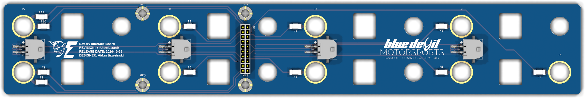
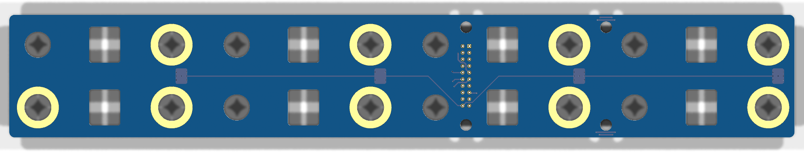

  

<h1 align="center">BATTERY_INTERFACE_BOARD</h1>

Battery Interface Board

<em>This board interfaces with the cell tap connctons fusing them, and collecting them to one connector.</em>

  

    

***

  
&nbsp; &nbsp; &nbsp; &nbsp;
  

***

## SPECIFICATIONS

| Parameter | Value |
| --- | --- |
| Dimensions | 300.0 × 47.0 mm |
| Company | Blue Devil Motor Sports |
| Designer | Aidan Brzezinski |
| Revision | + (Unreleased) |
